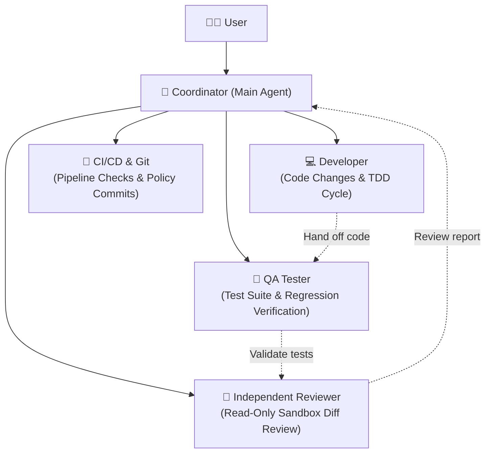
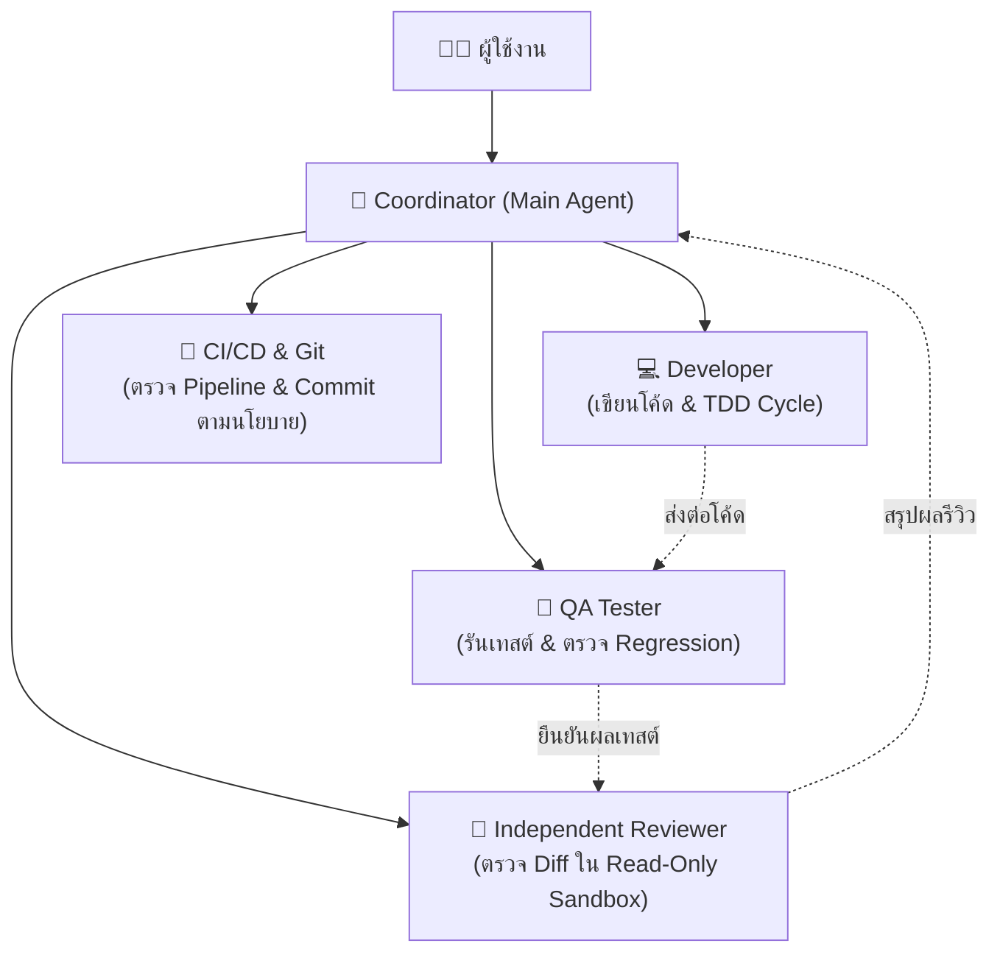

# ⚡ initskill — Local Agent Skill Manager CLI

<p align="center">
  <b>Elevate AI Coding Assistants (Codex & Google Antigravity) into a Professional Software Engineering Squad.</b><br>
  <b>ยกระดับ AI Coding Assistants (Codex & Google Antigravity) สู่ทีมวิศวกรรมซอฟต์แวร์มืออาชีพ</b>
</p>

<p align="center">
  <a href="#-english"><b>🇬🇧 English</b></a> &nbsp;•&nbsp; <a href="#-ภาษาไทย"><b>🇹🇭 ภาษาไทย</b></a>
</p>

<p align="center">
  <a href="https://github.com/Anuphap2/initskill/actions/workflows/ci.yml"></a>
  <a href="https://github.com/Anuphap2/initskill/actions/workflows/release.yml"></a>
  <a href="https://nodejs.org/">= 20"></a>
  
  
</p>

---

## 🇬🇧 English

Inject deterministic software engineering guardrails, specialized skills, and multi-agent orchestration into any workspace in a single command — **without altering your existing business code**.

### 🌟 Why `initskill`?

When using AI coding assistants (such as Google Antigravity or OpenAI Codex), developers frequently encounter critical pain points:
- ❌ **Uncontrolled AI Decisions**: Hallucinating architectural decisions or claiming tests passed without running them.
- ❌ **AI Slop**: Writing bloated, low-quality code with accumulating technical debt.
- ❌ **Reckless Commits**: Silently committing secrets, API tokens, or committing when test suites are failing.

**`initskill` solves this by provisioning an autonomous, disciplined engineering squad inside your workspace:**
- 🛡️ **Zero AI Slop & TDD First**: Enforces test-driven development (Red-Green-Refactor) with concrete verification evidence before concluding tasks.
- 🤖 **Multi-Agent Squad**: Establishes distinct specialized roles (Developer, QA Tester, Independent Reviewer, CI/CD, Git Release Manager).
- 🔒 **Git Guardrails**: Granular commit policies (`ask`, `auto`, `off`) preventing accidental secret leakage and unauthorized merges.
- 🚀 **100% Non-Destructive**: Manages `.agents/` and `AGENTS.md` cleanly without modifying your project code, backed by durable backups.

---

### 🚀 Quick Installation

System requirements: **Node.js 20 or later** (Windows, macOS, or Linux).

#### 🪟 Windows (PowerShell)
```powershell
git clone https://github.com/Anuphap2/initskill.git "$HOME\.agent-skills"; & "$HOME\.agent-skills\install.ps1"
```

#### 🍎 macOS / 🐧 Linux (Bash / Zsh)
```bash
git clone https://github.com/Anuphap2/initskill.git ~/.agent-skills && bash ~/.agent-skills/install.sh
```

> [!TIP]
> After running the install command, open a new terminal window. You can invoke `initskill` from any project directory!

---

### 🎮 30-Second Quickstart

1. **Navigate to your project root:**
   ```bash
   cd /path/to/your/project
   ```
2. **Run interactive setup:**
   ```bash
   initskill
   ```
   Choose your target environment:
   - **`Both (Recommended)`**: Supports both Google Antigravity and Codex simultaneously.
   - **`Google Antigravity`**: Optimized for Antigravity IDE & CLI.
   - **`Codex`**: Optimized for Codex CLI & IDE.
3. **Verify workspace integrity with `doctor`:**
   ```bash
   initskill doctor
   ```

---

### 📋 CLI Command Reference

| Command | Description |
| :--- | :--- |
| `initskill` | Interactive prompt-based initialization menu |
| `initskill doctor` | Diagnose workspace health and validate agent/skill configurations |
| `initskill doctor --json` | Output health diagnostic results in structured JSON (for CI / AI) |
| `initskill list --json` | List all built-in profiles and skills in JSON format |
| `initskill config git-policy <ask\|auto\|off>` | Configure the project Git commit policy |
| `initskill skill list --json` | Inspect project-local skills in `.agents/skills/` |
| `initskill skill inspect <name> --json` | View detailed trigger metadata and hash for a specific skill |
| `initskill skill create <name> --description "..."` | Scaffold a new project-local skill safely |
| `initskill skill validate --json` | Validate frontmatter and syntax of all project skills |

---

### ⚙️ Non-Interactive / CI Automation

```bash
# General profile for both Codex and Antigravity
initskill init --target both --mode agent --profile general --non-interactive

# Frontend design & Anti-AI-Slop profile
initskill init --target both --profile frontend --non-interactive

# Dry-run plan (preview changes without writing to disk)
initskill init --target both --dry-run
```

---

### 🤖 Autonomous Multi-Agent Squad

When initializing with `--mode agent`, `initskill` establishes structured engineering roles governed by `.agents/project/subagent-contract.md`:



#### Core Squad Rules:
1. **Disjoint Write Scopes**: Subagents operate in strictly separated file sets to prevent conflicting edits.
2. **Independent Reviewer**: The reviewer is isolated in a read-only sandbox and must not be the author of the code under review.
3. **Evidence-Based Acceptance**: Success claims require verifiable check/test execution outputs.
4. **Strict Git Safety**: Subagents cannot commit or push on their own; final authorization remains with the user.

---

### 📚 Built-in Skills Catalog

| Category | Skill | Key Purpose |
| :--- | :--- | :--- |
| **Core** | `core-no-assumptions` | Forbids assumptions; verifies requirements and contracts upfront |
| | `core-language-strategy` | Natural Thai technical communication while preserving English symbols |
| | `core-skill-authoring` | Safe creation, validation, and lifecycle management for agent skills |
| **Development** | `developer-implementation` | Lean code changes, technical debt control, and interface preservation |
| | `loop-test-tdd-cycle` | Test-driven development (Red-Green-Refactor) with verifiable test evidence |
| **Quality** | `tester-qa-strategy` | Risk-based testing, regression diagnosis, and environment isolation |
| | `loop-test-self-healing-test` | Repair test code safely without weakening assertion contracts |
| **Enterprise / Prod** | `security-vulnerability-hardening` | OWASP Top 10 mitigation, auth/tenancy checks, and PII protection |
| | `database-migration-safeguards` | Zero-downtime expand/contract schema evolution and table lock avoidance |
| | `devops-observability-health` | Production readiness, liveness/readiness probes, and structured JSON logs |
| **Delivery** | `cicd-pipeline-engineering` | GitHub Actions, Docker, CI/CD pipeline repair and deployment safety |
| | `git-repository-workflow` | Staged diff reviews, secret detection, and safe checkpoint commits |
| **Architecture** | `backend-nestjs-conventions` | NestJS modules, controllers, providers, and dependency injection |
| | `backend-mongodb-schema` | MongoDB schema design, indexing, and access pattern review |
| | `frontend-nextjs-app-router` | Next.js App Router, routing conventions, and server/client boundaries |
| | `frontend-tailwind` | Consistent design tokens, responsive layouts, and accessible UI states |
| **Team** | `team-engineering-team` | Coordination handoffs between Dev, QA, Reviewer, and CI/CD |
| | `team-subagent-orchestration` | Parallel delegation to subagents without conflicting edits |

---

### 🔄 Updating & Uninstallation

#### Updating
```bash
# Windows
cd "$HOME\.agent-skills"; git pull; .\install.ps1

# macOS / Linux
cd ~/.agent-skills && git pull && bash install.sh
```

#### Uninstallation
```bash
# Windows
& "$HOME\.agent-skills\uninstall.ps1"

# macOS / Linux
bash ~/.agent-skills/uninstall.sh
```

---

<br>

---

## 🇹🇭 ภาษาไทย

ติดตั้งมาตรฐานวิศวกรรม กฎระเบียบ (Rules), ทักษะเฉพาะทาง (Skills) และระบบ Multi-Agent Orchestration ลงในทุกโปรเจกต์ของคุณในคำสั่งเดียว — **โดยไม่แตะต้อง Business Code เดิม**

### 🌟 ทำไมต้องใช้ `initskill`?

เวลาใช้งาน AI ช่วยเขียนโค้ด ปัญหาใหญ่ที่นักพัฒนามักพบเจอคือ:
- ❌ **AI เพ้อเจ้อ / สุ่มตัดสินใจเอง**: สร้างสถาปัตยกรรมโดยไม่มีหลักยึด ไม่รันเทสต์แต่เคลมว่าโค้ดผ่าน
- ❌ **AI Slop**: สร้างโค้ดที่ดูดีผิวเผินแต่เต็มไปด้วยหนี้ทางเทคนิค (Technical Debt)
- ❌ **Commit ซี้ซั้ว**: แอบสร้าง commit เมื่อเทสต์ยังไม่ผ่าน หรืออาจเผลอนำ Secret / API Token หลุดขึ้น Git

**`initskill` เข้ามาแก้ปัญหานี้โดยสร้าง "ทีมวิศวกรอัตโนมัติ" ใน Workspace ของคุณ:**
- 🛡️ **Zero AI Slop & TDD First**: บังคับรอบ TDD จริง พร้อมแสดงผลลัพธ์เป็นหลักฐานก่อนเคลมว่างานเสร็จ
- 🤖 **Multi-Agent Squad**: จัดแบ่งบทบาทชัดเจน (Developer, QA Tester, Independent Reviewer, CI/CD, Git Release)
- 🔒 **Git Guardrails**: ควบคุมนโยบาย Git Commit (`ask`, `auto`, `off`) ป้องกัน Secret หลุดอย่างรัดกุม
- 🚀 **100% Non-Destructive**: ทำงานผ่าน `.agents/` และ `AGENTS.md` ไม่แก้โค้ดธุรกิจ และมีระบบสำรองไฟล์เดิม (Durable Backups) เสมอ

---

### 🚀 ติดตั้งด่วน (Quick Installation)

ความต้องการของระบบ: **Node.js 20 ขึ้นไป** (รองรับทั้ง Windows, macOS และ Linux)

#### 🪟 Windows (PowerShell)
```powershell
git clone https://github.com/Anuphap2/initskill.git "$HOME\.agent-skills"; & "$HOME\.agent-skills\install.ps1"
```

#### 🍎 macOS / 🐧 Linux (Bash / Zsh)
```bash
git clone https://github.com/Anuphap2/initskill.git ~/.agent-skills && bash ~/.agent-skills/install.sh
```

> [!TIP]
> เมื่อรันคำสั่งติดตั้งเสร็จ ให้เปิด Terminal ใหม่ คุณจะสามารถพิมพ์คำสั่ง `initskill` จากโฟลเดอร์โปรเจกต์ใดก็ได้ทันที!

---

### 🎮 เริ่มต้นใช้งานใน 30 วินาที

1. **เปิด Terminal ในโฟลเดอร์โปรเจกต์ของคุณ:**
   ```bash
   cd /path/to/your/project
   ```
2. **รันคำสั่งเริ่มทำงาน (Interactive Mode):**
   ```bash
   initskill
   ```
   เลือก AI ปลายทางที่คุณใช้งาน:
   - **`ใช้ร่วมกัน (Both)`** *(แนะนำ)*: รองรับทั้ง Codex และ Google Antigravity พร้อมกัน
   - **`Google Antigravity`**: สำหรับ Google Antigravity IDE & CLI
   - **`Codex`**: สำหรับ Codex CLI / IDE
3. **ตรวจสอบความพร้อมของ Workspace ด้วย `doctor`:**
   ```bash
   initskill doctor
   ```

---

### 📋 สรุปคำสั่งที่ใช้บ่อย (CLI Cheat Sheet)

| คำสั่ง | การทำงาน |
| :--- | :--- |
| `initskill` | เริ่มต้นใช้งานแบบถามตอบผ่านเมนู (Interactive TTY) |
| `initskill doctor` | ตรวจสอบสุขภาพ Workspace และความถูกต้องของ Agents/Skills |
| `initskill doctor --json` | แสดงผลตรวจสุขภาพในรูปแบบ JSON (สำหรับ CI / AI) |
| `initskill list --json` | แสดงรายชื่อ Profiles และ Skills ทั้งหมดที่มีในระบบ |
| `initskill config git-policy <ask\|auto\|off>` | ปรับนโยบาย Git Commit ของโปรเจกต์ |
| `initskill skill list --json` | ตรวจดู Skills เฉพาะของโปรเจกต์ (`.agents/skills/`) |
| `initskill skill inspect <name> --json` | ดูรายละเอียด, คำอธิบาย trigger และ hash ของ Skill |
| `initskill skill create <name> --description "..."` | ร่างโครงสร้าง Skill ใหม่ในโปรเจกต์อย่างปลอดภัย |
| `initskill skill validate --json` | ตรวจสอบความถูกต้องของโครงสร้าง Skills ทั้งหมดในโปรเจกต์ |

---

### ⚙️ การใช้งานแบบ Non-Interactive (เหมาะสำหรับ CI / Automation)

```bash
# ติดตั้งแบบมาตรฐานทั่วไป (General Profile รองรับทั้ง Codex และ Antigravity)
initskill init --target both --mode agent --profile general --non-interactive

# ติดตั้งเฉพาะกฎสาย Frontend (Anti-AI-Slop & UI/UX Design System)
initskill init --target both --profile frontend --non-interactive

# ตัวเลือกจำลองแผนก่อนทำจริง (Dry-run ไม่เขียนไฟล์ลงดิสก์)
initskill init --target both --dry-run
```

---

### 🤖 ระบบทีมวิศวกรอัตโนมัติ (Multi-Agent Squad)

เมื่อรัน `initskill init --mode agent` ระบบจะสร้างโครงสร้างทีมที่ทำงานประสานกันตามสัญญา `.agents/project/subagent-contract.md`:



#### กติกาการทำงานของทีม:
1. **Disjoint Write Scope**: แต่ละ Subagent แก้ไขไฟล์เฉพาะในขอบเขตหน้าที่ตัวเอง ไม่ทับซ้อนกัน
2. **Independent Reviewer**: ผู้ตรวจทาน (Reviewer) จะต้องเป็นคนละตัวกับคนเขียนโค้ด (ห้ามผู้เขียนตรวจงานตัวเอง)
3. **Evidence-Based Success**: ห้ามเคลมว่างานสำเร็จหากไม่มีหลักฐานการรัน Check / Tests มาแสดง
4. **Strict Git Safety**: Workers ไม่ทำ commit, push หรือ publish เอง สิทธิ์การตัดสินใจขั้นสุดท้ายเป็นของผู้ใช้

---

### 📚 แคตตาล็อก Skills ในระบบ (Skills Catalog)

| หมวดหมู่ | ชื่อ Skill | บทบาทและหน้าที่หลัก |
| :--- | :--- | :--- |
| **พื้นฐาน (Core)** | `core-no-assumptions` | สกัดกั้นการเดา, ใช้ Spec Template & AC, Protocol `[NEED_INFORMATION]` |
| | `core-language-strategy` | สื่อสารภาษาไทยอย่างเป็นธรรมชาติ และคง command/identifier ภาษาอังกฤษ |
| | `core-skill-authoring` | สร้าง ปรับปรุง และตรวจสอบความถูกต้องของ Skill ตามมาตรฐาน |
| **พัฒนาโค้ด (Dev)** | `developer-implementation` | Architecture First, Surgical Reading, ป้องกัน Script พังด้วย Deterministic Tooling |
| | `loop-test-tdd-cycle` | วงจร TDD (Red-Green-Refactor) พร้อมหลักฐานการรันเทสต์จริง |
| **ความปลอดภัย & Prod** | `security-vulnerability-hardening` | ป้องกัน OWASP Top 10, ตรวจสอบ Authorization/Tenancy, คุ้มครอง PII และ Secrets |
| | `database-migration-safeguards` | การย้าย Schema แบบ Zero-Downtime (Expand/Contract) ป้องกัน Table Lock |
| | `devops-observability-health` | ตรวจสอบความพร้อม Liveness/Readiness, Graceful Shutdown และ Structured JSON Logs |
| **คุณภาพ (QA)** | `tester-qa-strategy` | กฎเหล็ก Anti-Fake-Done, ทดสอบครอบคลุม Edge Cases, บังคับ Execution Evidence |
| | `loop-test-self-healing-test` | ซ่อมแซมโค้ดเทสต์อย่างปลอดภัย ไม่ลดความเข้มงวดของ assertion |
| **จัดส่ง (Delivery)** | `cicd-pipeline-engineering` | จัดการ GitHub Actions, Docker, ตรวจสอบ Pipeline และความปลอดภัยในการ Deploy |
| | `git-repository-workflow` | ตรวจสอบ staged diff, สกัดกั้นการ commit secrets, ควบคุม checkpoint commits |
| **สถาปัตยกรรม** | `backend-nestjs-conventions` | NestJS modules, controllers, providers และ DI conventions |
| | `backend-mongodb-schema` | ออกแบบ MongoDB schema, indexing และ access patterns |
| | `frontend-nextjs-app-router` | Next.js App Router, routing และ server/client boundaries |
| | `frontend-tailwind` | ดีไซน์โทเคน, responsive layout และ accessible UI states |
| **ทีมงาน (Team)** | `team-engineering-team` | ขั้นตอน Definition of Done และการประสานงานในทีมวิศวกร |
| | `team-subagent-orchestration` | รูปแบบ Big Agent teaches Small Agent และการกระจายงานให้ Subagents |

---

### 🔄 การอัปเดตและถอนการติดตั้ง

#### 1. การอัปเดตเป็นเวอร์ชันล่าสุด
```powershell
# Windows
cd "$HOME\.agent-skills"; git pull; .\install.ps1
```
```bash
# macOS / Linux
cd ~/.agent-skills && git pull && bash install.sh
```

#### 2. การถอนการติดตั้ง
```powershell
# Windows
& "$HOME\.agent-skills\uninstall.ps1"
```
```bash
# macOS / Linux
bash ~/.agent-skills/uninstall.sh
```

---

## 🛡️ Security & Integrity / มาตรฐานความปลอดภัย

- **Atomic Writes**: Safe atomic writes via temporary files before renaming / เขียนไฟล์ผ่าน temp file ก่อนสลับชื่อเสมอ
- **Durable Backups**: Existing user files are securely backed up in `.agent-skills-backups/` / สำรองไฟล์เดิมไว้เสมอ
- **Path Traversal Protection**: Enforces strict canonical path and symlink boundary defenses across Windows, macOS, and Linux / ป้องกันการหลุดออกนอก Workspace อย่างรัดกุม
- **Cross-Platform Verified**: Automated CI test suite (62 tests) across Node 20 & 22 on Windows, macOS, and Ubuntu / ผ่านการทดสอบระดับ Matrix ข้ามทุก OS

---

## 📄 License / ใบอนุญาต

Maintained and developed by [Anuphap2](https://github.com/Anuphap2).
