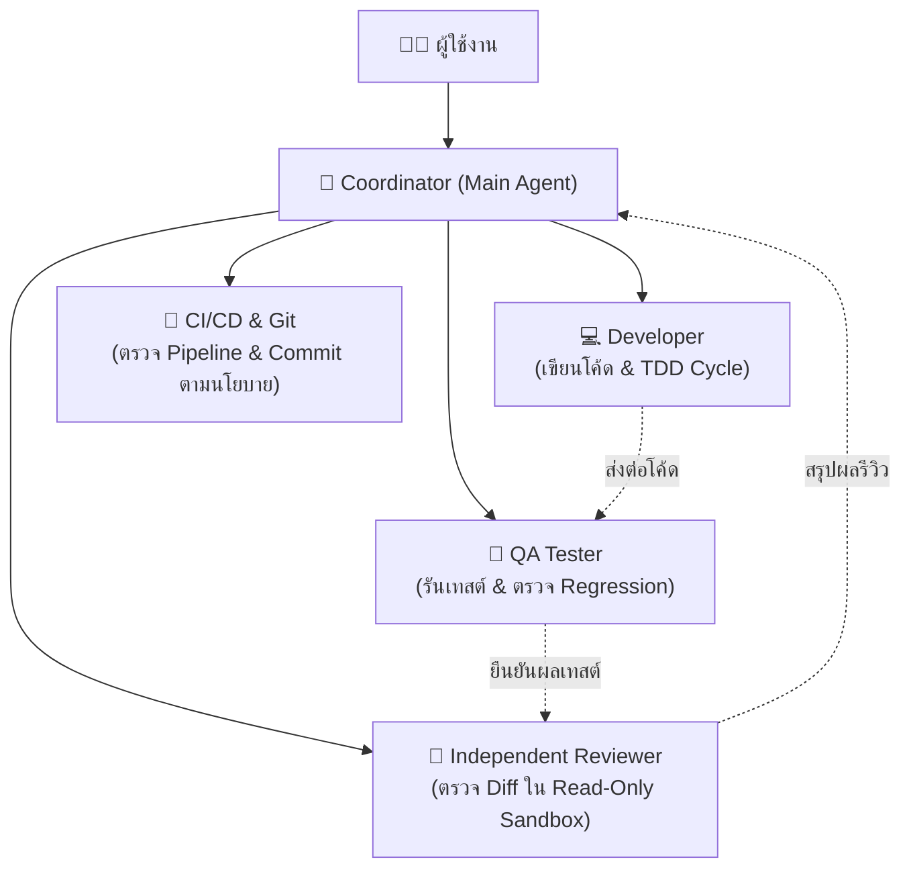

# ⚡ initskill — Local Agent Skill Manager CLI

> **ยกระดับ AI Coding Assistants (Codex & Google Antigravity) สู่ทีมวิศวกรรมซอฟต์แวร์มืออาชีพ**  
> ติดตั้งมาตรฐานวิศวกรรม กฎระเบียบ (Rules), ทักษะเฉพาะทาง (Skills) และระบบ Multi-Agent Orchestration ลงในทุกโปรเจกต์ของคุณในคำสั่งเดียว — **โดยไม่แตะต้อง Business Code เดิม**

[](https://github.com/Anuphap2/initskill/actions/workflows/ci.yml)
[](https://github.com/Anuphap2/initskill/actions/workflows/release.yml)
[](https://nodejs.org/)
[](#)
[](#)

---

## 🌟 ทำไมต้องใช้ `initskill`?

เวลาใช้งาน AI ช่วยเขียนโค้ด ปัญหาใหญ่ที่นักพัฒนามักพบเจอคือ:
- ❌ **AI เพ้อเจ้อ / สุ่มตัดสินใจเอง**: สร้างสถาปัตยกรรมโดยไม่มีหลักยึด ไม่รันเทสต์แต่เคลมว่าโค้ดผ่าน
- ❌ **AI Slop**: สร้างโค้ดที่ดูดีผิวเผินแต่เต็มไปด้วยหนี้ทางเทคนิค (Technical Debt)
- ❌ **Commit ซี้ซั้ว**: แอบสร้าง commit เมื่อเทสต์ยังไม่ผ่าน หรืออาจเผลอนำ Secret / API Token หลุดขึ้น Git

**`initskill` เข้ามาแก้ปัญหานี้โดยสร้าง "ทีมวิศวกรอัตโนมัติ" ใน Workspace ของคุณ:**
- 🛡️ **Zero AI Slop & TDD First**: บังคับรอบ TDD จริง พร้อมแสดงผลลัพธ์เป็นหลักฐานก่อนเคลมว่างานเสร็จ
- 🤖 **Multi-Agent Squad**: จัดแบ่งบทบาทชัดเจน (Developer, QA Tester, Independent Reviewer, CI/CD, Git Release)
- 🔒 **Git Guardrails**: ควบคุมนโยบาย Git Commit (`ask`, `auto`, `off`) ป้องกัน Secret หลุดอย่างรัดกุม
- 🚀 **100% Non-Destructive**: ทำงานผ่าน `.agents/` และ `AGENTS.md` ไม่แก้โค้ดธุรกิจ และมีระบบสำรองไฟล์เดิม (Durable Backups) เสมอ

---

## 🚀 ติดตั้งด่วน (Quick Installation)

ความต้องการของระบบ: **Node.js 20 ขึ้นไป** (รองรับทั้ง Windows, macOS และ Linux)

### 🪟 Windows (PowerShell)
```powershell
git clone https://github.com/Anuphap2/initskill.git "$HOME\.agent-skills"; & "$HOME\.agent-skills\install.ps1"
```

### 🍎 macOS / 🐧 Linux (Bash / Zsh)
```bash
git clone https://github.com/Anuphap2/initskill.git ~/.agent-skills && bash ~/.agent-skills/install.sh
```

> [!TIP]
> เมื่อรันคำสั่งติดตั้งเสร็จ ให้เปิด Terminal ใหม่ คุณจะสามารถพิมพ์คำสั่ง `initskill` จากโฟลเดอร์โปรเจกต์ใดก็ได้ทันที!

---

## 🎮 เริ่มต้นใช้งานใน 30 วินาที

### 1. เปิด Terminal ในโฟลเดอร์โปรเจกต์ของคุณ
```bash
cd /path/to/your/project
```

### 2. รันคำสั่งเริ่มทำงาน (Interactive Mode)
```bash
initskill
```
เลือก AI ปลายทางที่คุณใช้งาน:
- **`ใช้ร่วมกัน (Both)`** *(แนะนำ)*: รองรับทั้ง Codex และ Google Antigravity พร้อมกัน
- **`Google Antigravity`**: สำหรับ Google Antigravity IDE & CLI
- **`Codex`**: สำหรับ Codex CLI / IDE

### 3. ตรวจสอบความพร้อมของ Workspace ด้วย `doctor`
```bash
initskill doctor
```
ระบบจะสแกนความถูกต้องของไฟล์การตั้งค่า, ความปลอดภัย และสิทธิ์ของ Agent ทันที

---

## 📋 สรุปคำสั่งที่ใช้บ่อย (CLI Cheat Sheet)

| คำสั่ง | การทำงาน |
| :--- | :--- |
| `initskill` | เริ่มต้นใช้งานแบบถามตอบผ่านเมนู (Interactive TTY) |
| `initskill doctor` | ตรวจสอบสุขภาพ Workspace และความถูกต้องของ Agents/Skills |
| `initskill doctor --json` | แสดงผลตรวจสุขภาพในรูปแบบ JSON (สำหรับ CI / AI) |
| `initskill list --json` | แสดงรายชื่อ Profiles และ Skills ทั้งหมดที่มีในระบบ |
| `initskill config git-policy <ask\|auto\|off>` | ปรับนโยบาย Git Commit ของโปรเจกต์ |
| `initskill skill list --json` | ตรวจดู Skills เฉพาะของโปรเจกต์ (`.agents/skills/`) |
| `initskill skill inspect <name> --json` | ดูรายละเอียด, คำอธิบาย trigger และ hash ของ Skill |
| `initskill skill create <name> --description "..."` | ร่างโครงสร้าง Skill ใหม่ในโปรเจกต์อย่างปลอดภัย |
| `initskill skill validate --json` | ตรวจสอบความถูกต้องของโครงสร้าง Skills ทั้งหมดในโปรเจกต์ |

---

## ⚙️ การใช้งานแบบ Non-Interactive (เหมาะสำหรับ CI / Automation)

หากต้องการให้ AI Assistant หรือสคริปต์อัตโนมัติติดตั้ง Workspace โดยไม่ต้องรอกดเมนู:

```bash
# ติดตั้งแบบมาตรฐานทั่วไป (General Profile รองรับทั้ง Codex และ Antigravity)
initskill init --target both --mode agent --profile general --non-interactive

# ติดตั้งเฉพาะกฎสาย Frontend (Anti-AI-Slop & UI/UX Design System)
initskill init --target both --profile frontend --non-interactive

# ตัวเลือกจำลองแผนก่อนทำจริง (Dry-run ไม่เขียนไฟล์ลงดิสก์)
initskill init --target both --dry-run
```

### ตัวเลือกหลักของคำสั่ง `init`:
- `--target <both|antigravity|codex|auto>`: เลือก AI Assistant ที่ต้องการรองรับ
- `--mode <agent|skill>`: เลือกสไตล์ผลลัพธ์ (`agent` สร้าง Subagents ครบทีม / `skill` สร้างเฉพาะคลังทักษะ)
- `--profile <general|developer|tester|delivery|frontend>`: เลือกชุดกฎและทักษะตามประเภทงาน
- `--rules <id,id,...>`: เลือกทักษะเฉพาะเจาะจงตาม ID (ใช้แทน `--profile`)
- `--commit-policy <ask|auto|off>`: กำหนดนโยบาย Git Commit
- `--on-conflict <error|keep|overwrite>`: จัดการกรณีไฟล์ชนกัน (มีระบบสำรองไฟล์เดิมอัตโนมัติ)

---

## 🤖 ระบบทีมวิศวกรอัตโนมัติ (Multi-Agent Squad)

เมื่อรัน `initskill init --mode agent` ระบบจะสร้างโครงสร้างทีมที่ทำงานประสานกันตามสัญญา `.agents/project/subagent-contract.md`:



### กติกาการทำงานของทีม:
1. **Disjoint Write Scope**: แต่ละ Subagent แก้ไขไฟล์เฉพาะในขอบเขตหน้าที่ตัวเอง ไม่ทับซ้อนกัน
2. **Independent Reviewer**: ผู้ตรวจทาน (Reviewer) จะต้องเป็นคนละตัวกับคนเขียนโค้ด (ห้ามผู้เขียนตรวจงานตัวเอง)
3. **Evidence-Based Success**: ห้ามเคลมว่างานสำเร็จหากไม่มีหลักฐานการรัน Check / Tests มาแสดง
4. **Strict Git Safety**: Workers ไม่ทำ commit, push หรือ publish เอง สิทธิ์การตัดสินใจขั้นสุดท้ายเป็นของผู้ใช้

---

## 📚 คลังทักษะมาตรฐานที่ติดตั้งมาให้ (Built-in Skills)

| หมวดหมู่ | ทักษะ (Skill) | หน้าที่สำคัญ |
| :--- | :--- | :--- |
| **Core** | `core-no-assumptions` | ห้ามเดาเอง บังคับให้ตรวจสอบข้อเท็จจริงและสัญญาก่อนลงมือ |
| | `core-language-strategy` | สื่อสารภาษาไทยอย่างเป็นธรรมชาติ รักษารหัสคำสั่งภาษาอังกฤษ |
| | `core-skill-authoring` | วิธีการสร้างและปรับแต่ง Agent Skill อย่างปลอดภัย |
| **Development** | `developer-implementation` | พัฒนาฟีเจอร์อย่างกระชับ ควบคุมหนี้ทางเทคนิค และรักษา interface |
| | `loop-test-tdd-cycle` | พัฒนาโค้ดด้วยรอบ TDD (Red-Green-Refactor) พร้อมแสดงหลักฐานเทสต์ |
| **Quality** | `tester-qa-strategy` | ออกแบบชุดทดสอบความเสี่ยง แยก failure ของโค้ดและสภาพแวดล้อม |
| | `loop-test-self-healing-test` | ตรวจซ่อมแซมโค้ดทดสอบโดยไม่ลดทอน assertion |
| **Delivery** | `cicd-pipeline-engineering` | จัดการ Pipeline, GitHub Actions, Docker และ Deployment |
| | `git-repository-workflow` | จัดการ Git Checkpoints, Staged Diffs และตรวจจับ Secrets |
| **Architecture** | `backend-nestjs-conventions` | แนวทางและมาตรฐานการพัฒนา NestJS architecture |
| | `backend-mongodb-schema` | ออกแบบและทบทวน MongoDB schema, indexes และ query pattern |
| | `frontend-nextjs-app-router` | มาตรฐานการพัฒนา Next.js App Router และ Client/Server boundary |
| | `frontend-tailwind` | จัดการ Design token และ Accessible UI states |
| **Team** | `team-engineering-team` | ประสานงานส่งมอบระหว่าง Dev, QA, Reviewer และ CI/CD |
| | `team-subagent-orchestration` | มอบหมายงานแบบขนานและรวมผลงานโดยไม่ขัดแย้งกัน |

---

## 🔧 การสร้างและปรับแต่ง Skill ประจำโปรเจกต์

คุณสามารถให้ AI หรือตัวคุณเองสร้าง Skill เฉพาะทางเพิ่มได้ใน `.agents/skills/`:

```bash
# 1. ร่าง Skill ใหม่
initskill skill create my-custom-tool --description "Automate specialized database migration"

# 2. ดูข้อมูลและ Hash ของ Skill
initskill skill inspect my-custom-tool --json

# 3. อัปเดต Skill โดยมีการตรวจสอบ Hash ป้องกันการเขียนทับซ้อน
initskill skill update my-custom-tool --from-file draft/SKILL.md --expected-hash <hash>

# 4. ตรวจสอบความถูกต้องของทุก Skill ในโปรเจกต์
initskill skill validate
```

---

## 🔄 การอัปเดตและถอนการติดตั้ง

### 1. การอัปเดตเป็นเวอร์ชันล่าสุด
ดึงโค้ดล่าสุดแล้วรันสคริปต์ติดตั้งทับได้เลย (ระบบจะเก็บไฟล์ที่คุณแก้ไขเองไว้ให้เสมอ):
- **Windows:**
  ```powershell
  cd "$HOME\.agent-skills"; git pull; .\install.ps1
  ```
- **macOS / Linux:**
  ```bash
  cd ~/.agent-skills && git pull && bash install.sh
  ```

### 2. การถอนการติดตั้ง
- **Windows:**
  ```powershell
  & "$HOME\.agent-skills\uninstall.ps1"
  ```
- **macOS / Linux:**
  ```bash
  bash ~/.agent-skills/uninstall.sh
  ```

---

## 🛡️ มาตรฐานความปลอดภัย (Safety & Integrity)

- **Atomic Writes**: เขียนไฟล์แบบ Atomic ผ่าน temp file ก่อนสลับชื่อ ป้องกันไฟล์เสียหายเมื่อเกิดข้อผิดพลาดกลางคัน
- **Durable Backups**: ไฟล์ที่เคยถูกแก้ไขโดยผู้ใช้ จะถูกสำรองเก็บไว้ใน `.agent-skills-backups/` ก่อนแก้ไขเสมอ
- **Path Traversal Protection**: มีระบบป้องกัน Symlink Escapes อย่างรัดกุม รองรับทั้งโครงสร้าง Canonical Path ของ macOS, Windows Junctions และ POSIX
- **Cross-Platform Verified**: ผ่านการทดสอบอัตโนมัติ 62 tests ครอบคลุม Node.js 20 และ 22 บน Windows, macOS และ Ubuntu ผ่าน GitHub Actions ทุกครั้งก่อน Release

---

## 📄 ใบอนุญาต (License)

โปรเจกต์นี้ดูแลและพัฒนาโดย [Anuphap2](https://github.com/Anuphap2) รองรับการใช้งานเพื่อยกระดับประสิทธิภาพ AI Coding Assistant ในทุกโปรเจกต์
